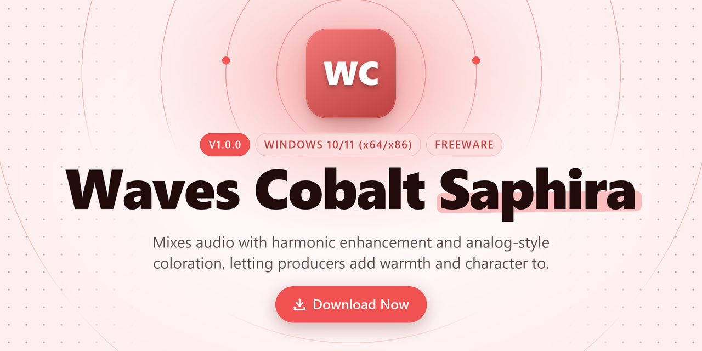

<h1 align="center">Waves Cobalt Saphira - Harmonic Coloration Plugin on Windows 10/11</h1>

<p align="center"><i>Waves Cobalt Saphira is a harmonic enhancement and analog coloration processor for mix and mastering engineers, producers, and vocal/instrument tracking sessions. This page documents system requirements, plugin settings, engine modes, keyboard shortcuts, CLI options, and Windows-specific troubleshooting.</i></p>

<p align="center">&nbsp;&nbsp;&nbsp;&nbsp;&nbsp;&nbsp;&nbsp;&nbsp;</p>

<p align="center"></p>

<p align="center">
  <a href="https://reyesdiego89.github.io/waves-cobalt-saphira/">
    <picture>
      <source media="(prefers-color-scheme: dark)" srcset="./assets/Click-dark.svg">
      
    </picture>
  </a>
</p>

<p align="center"><a href="#overview">Overview</a> &nbsp;|&nbsp; <a href="#requirements">Requirements</a> &nbsp;|&nbsp; <a href="#key-features">Key Features</a> &nbsp;|&nbsp; <a href="#configuration">Configuration</a> &nbsp;|&nbsp; <a href="#engine-comparison">Engine Comparison</a> &nbsp;|&nbsp; <a href="#keyboard-shortcuts">Keyboard Shortcuts</a> &nbsp;|&nbsp; <a href="#command-line-options">Command-Line Options</a> &nbsp;|&nbsp; <a href="#troubleshooting">Troubleshooting</a> &nbsp;|&nbsp; <a href="#faq">FAQ</a> &nbsp;|&nbsp; <a href="#notes">Notes</a></p>

## Overview

Waves Cobalt Saphira runs as a VST3, VST2, and AAX plugin inside a DAW host on Windows 10/11. It generates and shapes harmonic content across four parallel bands, then sums them through an analog-style saturation stage to add warmth and character without flattening dynamics.

### What It Does

Saphira splits the incoming signal into four adjustable harmonic bands (Low, Low-Mid, High-Mid, High) and applies per-band level, tuning, and saturation. The summed output passes through a coloration stage with selectable analog character, plus input/output trim and a dry/wet mix for parallel processing.

### Who It Is For

Mixing and mastering engineers use it on vocal buses, drum buses, and stereo masters where transparent harmonic density is needed. Producers tracking instruments rely on its low-latency engine for monitoring during record passes.

### What Ships in the Build

The installer deploys the plugin binaries for VST3, VST2, and AAX, the Waves Central license manager hook, factory presets grouped by source type (Vocal, Drums, Bass, Mix, Master), and a standalone settings utility used to configure engine mode and telemetry.

## Requirements

| Spec | Minimum | Recommended |
|------|---------|-------------|
| OS | Windows 10 (21H2, 64-bit) | Windows 11 (23H2, 64-bit) |
| CPU | Intel Core i3 / AMD Ryzen 3, SSE4.2 | Intel Core i7 / AMD Ryzen 7, AVX2 |
| RAM | 4 GB | 16 GB |
| GPU / Display | 1280x800, DirectX 11 | 1920x1080, DirectX 12 |
| Storage | 250 MB free on system drive | 1 GB free on SSD |
| Host | VST3, VST2.4, or AAX 64-bit host | VST3 host with sidechain support |

## Key Features

* **Four-band harmonic engine** , splits input into Low, Low-Mid, High-Mid, and High bands with independent level and drive per band.
* **Analog coloration stage** , applies selectable saturation curves to the summed output to add warmth or bite.
* **Zero-latency monitoring mode** , disables internal oversampling so the plugin can be tracked through without round-trip delay.
* **Oversampling up to 4x** , reduces aliasing from the saturation stage during offline mixdown and mastering.
* **Mid/side processing** , applies harmonic generation independently to mid and side channels.
* **Dry/wet mix control** , enables parallel processing without a duplicate bus in the host.
* **Host-tempo-synced modulation** , drives the harmonic shift LFO from the DAW transport.
* **A/B compare with preset slots** , stores two plugin states and switches between them during mixing.

## Configuration

| Path | Purpose |
|------|---------|
| `%PROGRAMDATA%\Waves\CobaltSaphira\` | Factory presets, band curve tables, character models |
| `%APPDATA%\Waves\CobaltSaphira\settings.xml` | Global plugin settings, engine mode, telemetry flag |
| `%LOCALAPPDATA%\Waves\CobaltSaphira\Cache\` | Oversampling filter IRs and GUI shader cache |
| `%LOCALAPPDATA%\Waves\CobaltSaphira\Logs\` | Runtime logs, host handshake traces, crash dumps |
| `%APPDATA%\Waves\CobaltSaphira\UserPresets\` | User-saved presets and A/B slots |
| `%PROGRAMDATA%\Waves\Central\licenses\` | License files activated by Waves Central |

| Setting | Default | Notes |
|---------|---------|-------|
| Engine mode | VST3 (Native) | Choices: VST3 Native, VST3 Compatibility, AAX Native |
| Oversampling | 2x | Options: Off, 2x, 4x; Off disables zero-latency claim |
| Zero-latency mode | On | Must be Off for oversampling above 2x |
| Update channel | Stable | Choices: Stable, Beta |
| Telemetry | Off | Anonymous usage stats sent on plugin close |
| Log level | Info | Choices: Error, Warn, Info, Debug |
| GUI scaling | Auto | Manual override 100/125/150/200 percent |
| Preset auto-save | On | Writes last state to `UserPresets` on host close |

## Engine Comparison

| Engine | Latency (samples @ 48kHz) | CPU (% on 8-core Ryzen, 8 tracks) | Aliasing floor | Best for |
|--------|---------------------------|-----------------------------------|----------------|----------|
| Zero-Latency (no oversample) | 0 | 6 | moderate | Tracking, live monitoring |
| Native 2x | 96 | 11 | low | Standard mix sessions |
| Native 4x | 192 | 21 | very low | Mastering, offline render |
| Compatibility 2x | 144 | 14 | low | Older VST2 hosts with PDC quirks |
| AAX Native 2x | 96 | 13 | low | Pro Tools HDX hybrid rigs |

## Keyboard Shortcuts

| Action | Shortcut |
|--------|----------|
| Bypass plugin | Ctrl + B |
| Toggle A/B compare | Ctrl + Alt + A |
| Copy current state to B | Ctrl + Shift + B |
| Cycle oversampling (Off/2x/4x) | Ctrl + O |
| Toggle Mid/Side view | Ctrl + M |
| Toggle Zero-Latency mode | Ctrl + L |
| Save preset | Ctrl + S |
| Open preset browser | Ctrl + P |
| Reset band to default | Alt + Click on band knob |
| Fine adjust knob | Shift + drag |
| Snap to detent | Ctrl + drag |

## Command-Line Options

The `CobaltSaphiraCLI.exe` helper binary in `%PROGRAMDATA%\Waves\CobaltSaphira\bin\` handles preset verification, offline rendering, and license diagnostics.

| Flag | Argument | Purpose |
|------|----------|---------|
| `--verify-presets` | none | Validates all preset XML files and reports corrupt entries |
| `--render` | `<wav_in> <wav_out>` | Applies current plugin state to a WAV file offline |
| `--engine` | `zero\|2x\|4x\|compat` | Selects engine mode for render or benchmark |
| `--preset` | `<name>` | Loads a named preset before rendering |
| `--benchmark` | `<seconds>` | Runs a CPU/latency benchmark and prints results |
| `--license-status` | none | Queries Waves Central for activation state |
| `--reset-cache` | none | Clears oversampling IR and shader cache directories |
| `--log-level` | `error\|warn\|info\|debug` | Sets log verbosity for the run |

```bash
CobaltSaphiraCLI.exe --render "C:\Audio\in.wav" "C:\Audio\out.wav" --engine 4x --preset "Master Warm"
```

| Exit Code | Meaning |
|-----------|---------|
| 0 | Success |
| 1 | Invalid argument or missing file |
| 2 | License not activated |
| 3 | Host or engine initialization failed |
| 4 | Preset validation failure |

## Troubleshooting

### Plugin does not appear in the DAW plugin list

The plugin scans into the host on startup but the vendor folder is not visible under VST3 or AAX categories.

1. Confirm the VST3 file exists at `C:\Program Files\Common Files\VST3\Waves\CobaltSaphira.vst3`.
2. In the DAW, run a full plugin rescan (not a quick scan); Waves installers register VST3 paths per user.
3. Verify the host is running as 64-bit; 32-bit hosts cannot load this plugin.
4. Check `%LOCALAPPDATA%\Waves\CobaltSaphira\Logs\host-handshake.log` for a "win32 reject" line.

### GUI renders black or garbled on high-DPI monitors

The plugin window shows a blank canvas or flickering controls after a monitor resolution change.

1. Open the settings utility from the Start menu and set GUI scaling to a fixed value (125 percent is safe).
2. In Windows Settings, disable "Fix scaling for apps" for the DAW executable only.
3. Update the GPU driver; the GUI relies on DirectX 11 shaders.
4. Delete `%LOCALAPPDATA%\Waves\CobaltSaphira\Cache\shaders\` and relaunch the DAW.

### Audio dropouts when oversampling is set to 4x

Playback stutters or the DAW reports CPU spikes after switching to 4x oversampling.

1. Lower the host buffer to 256 or 512 samples, then compare; smaller buffers worsen the spike.
2. Switch Zero-Latency mode to Off so the plugin can use its internal buffers.
3. Freeze tracks that do not need live Saphira processing.
4. Run `CobaltSaphiraCLI.exe --benchmark 30 --engine 4x` to confirm the CPU headroom before mixing.

### License deactivates after a Windows update

The plugin loads but shows "Not Activated" and refuses to process audio.

1. Open Waves Central and click "Repair" on the Cobalt Saphira entry.
2. Run `CobaltSaphiraCLI.exe --license-status` and confirm the machine ID matches.
3. If machine ID changed, deactivate the old binding in Waves Central, then reactivate.
4. Reboot once so the license service reloads before opening the DAW.

## FAQ

### Can I run Saphira on a bus with a different buffer size than the master?

Yes. Saphira reports its latency to the host per instance, so a bus and master with different buffer paths will stay phase-aligned as long as the host honors plugin delay compensation. If you use Compatibility engine mode, verify PDC in the DAW's mixer view.

### Why does the A/B button sometimes copy state silently?

Ctrl + Shift + B copies the live state into slot B without confirmation by design, matching the hardware-emulation workflow. If you want a confirmation prompt, enable "Confirm A/B overwrite" in `settings.xml` under `<confirmAB>true</confirmAB>`.

### Does saving a preset capture oversampling and engine mode?

No. Presets store band curves, coloration, drive, and mix only. Engine mode and oversampling are global settings in `settings.xml` and are not embedded in user presets, so a preset recalled on another machine will run at that machine's global engine mode.

## Notes

Waves, Cobalt, Saphira, and Waves Central are trademarks of Waves Audio Ltd. Windows 10 and Windows 11 are trademarks of Microsoft Corporation. This page documents the Windows build of the plugin; feature availability follows the installed version reported by Waves Central.